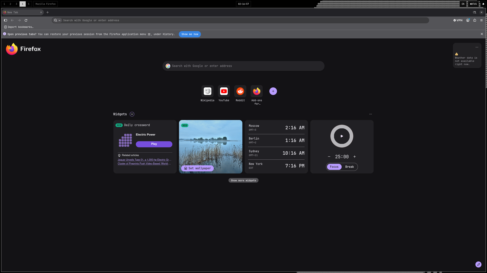
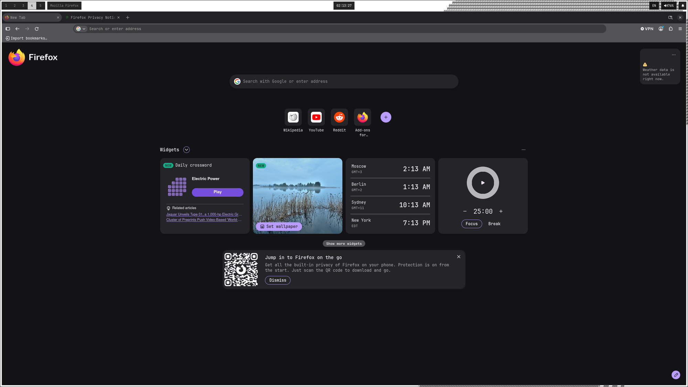
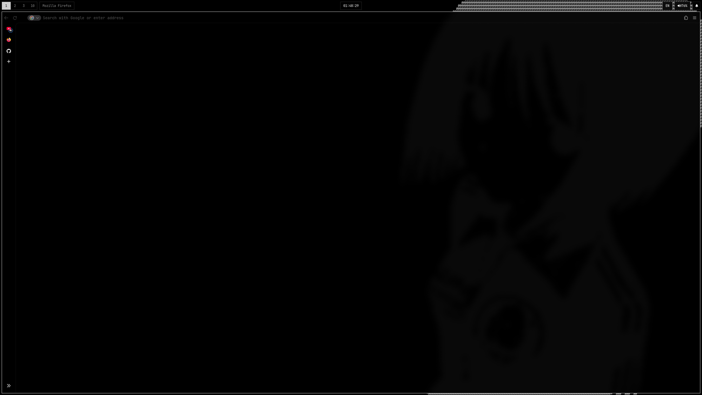
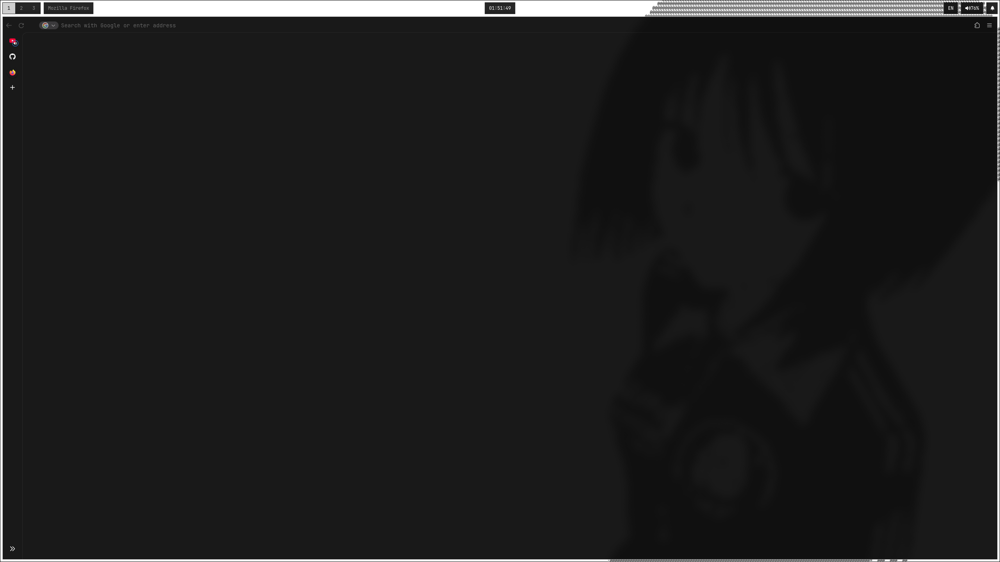

# firesex

A Firefox config for one person who wants a browser that is fast, quiet and doesn't phone home.

No extensions bundled, no policies, no forks. Three plain files that Firefox reads on startup.

| file | what it does |
| --- | --- |
| `user.js` | ~300 prefs: telemetry, Mozilla's junk, network leaks, TLS, caching |
| `userChrome.css` | black see-through UI, auto-hiding toolbar, no clutter buttons |
| `userContent.css` | makes `about:blank` and the new tab transparent to match |

| | dark wallpaper | light wallpaper |
| --- | --- | --- |
| **stock** |  |  |
| **firesex** |  |  |

Written and tested on Firefox 157, Linux (Wayland). Everything is commented in `user.js`, one line per pref, so you can read why before you keep it.

## What you get

**Quiet.** Telemetry, crash and health reports, studies, Normandy, sponsored tiles, Pocket-style recommendations, "what's new" pages, remote content from Mozilla, AI/ML features (chatbot, Smart Window, link previews), the VPN upsell, Firefox Accounts. All off.

**Less leaky.** Prefetch and speculative connections are off, geolocation and the Referer header are trimmed, ETP is on strict. HTTPS-only mode is on, TLS 1.2 is the floor, weak ciphers are gone, CRLite handles revocation.

**Faster.** Tabs restore on demand, sessions save once a minute instead of every 15 seconds, dead tabs unload under memory pressure, a bigger in-memory cache, more bfcache, hardware video decoding. The disk cache stays on and gets wiped on exit, nothing else does.

**Clean UI.** Black, translucent window, tabs in an expanding sidebar, the toolbar slides in when you hover the top edge. Buttons you never click (Firefox View, account, reader mode, share, translate, PiP, AI) are hidden. The bookmarks bar only shows on a new tab.

## Install

```sh
git clone https://github.com/rem22p/firesex
cd firesex
./install.sh -n     # dry run, shows what it would do
./install.sh        # symlinks into your default profile
```

Then fully quit Firefox and start it again.

The script finds your profile through `profiles.ini` (regular, `.mozilla`, snap and flatpak), symlinks the files so `git pull` updates the browser, and moves anything it would overwrite to `*.bak.<date>`.

| flag | |
| --- | --- |
| `-p PATH` | use this profile instead of the detected one |
| `-c` | copy files instead of symlinking |
| `-n` | dry run |
| `-u` | uninstall |

It is Linux only. On Windows and macOS, copy `user.js` to the profile root and the two CSS files to `<profile>/chrome/` yourself. The config itself isn't Linux specific, I just haven't tested it elsewhere. Your profile folder is listed in `about:support`.

## Things worth knowing

- `userChrome.css` only loads because `user.js` sets `toolkit.legacyUserProfileCustomizations.stylesheets`.
- The see-through look needs a compositor. On a plain X11 session, change `--fx-bg` in `userChrome.css` to `rgb(0, 0, 0)`.
- Deleting a line from `user.js` does **not** bring the default back. The value stays in `prefs.js`. Reset it in `about:config` or set it to the default explicitly.
- Prefs I looked at and left alone are kept in `user.js` as commented-out lines with the reason.

## What this doesn't do, on purpose

This is a daily-driver config, not a tinfoil one. So:

- `privacy.resistFingerprinting` is off. It breaks too much and ETP strict covers the cheap part.
- WebRTC works. Calls and camera need it.
- DoH, Safe Browsing and automatic updates are left at their defaults. Updates matter more than the privacy they might cost.
- The built-in password manager stays. Cookies and history survive a restart.
- No `policies.json`, no containers, JavaScript and WebGL stay on.

If you want the hard-line version, [arkenfox](https://github.com/arkenfox/user.js) is the thing to read. A lot of what is here was checked against it and Betterfox.

## Undo

```sh
./install.sh -u
```

removes the files. The prefs stay in `prefs.js` until you reset them, see above.
